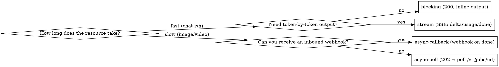

# Actionow integration

## Overview

**Actionow (actionow-core) is a multi-tenant AI-relay gateway with an OpenAI-compatible `/v1` API.** You call it for chat / image / video / audio / embeddings, and it handles provider keys, routing, fallback, circuit-breaking, a credit ledger, payments, object storage, and a per-end-user billing identity.

**Core principle — federation, not mirroring:** your app keeps its own database, users, and business logic. It runs a thin server that holds an Actionow credential and calls Actionow, referencing it **only by the stable IDs Actionow returns** — `subject_id`, `file_id`, `job_id`. If it touches a _provider key, a credit, or a stored byte_, it's Actionow's; everything that makes your product yours stays yours.

**If you are a coding agent:** you almost certainly do NOT have Actionow's source code. This skill IS your contract. Do not invent endpoints, parameters, or response shapes — everything you need is in this skill and its `reference/` sub-skills. When unsure, run `scripts/smoke-test.sh` against a live gateway instead of guessing.

## When to use

- Building an app _on top of_ an Actionow gateway (chatbot, image/video generator, RAG, agent backend).
- Wiring up auth, credits/billing, async jobs, file uploads, or webhooks against `/v1/*` or `/console/*`.
- Debugging a `401 / 402 / 429` from an Actionow gateway, or a mid-stream SSE error.

**Not for:** operating/deploying Actionow itself (that's the platform operator's `/admin` plane + `docs/DEPLOYMENT.md`), or provider-plugin authoring.

## The mental model — four planes

Every request belongs to exactly one plane, and each plane has its own credential. **An app backend almost only ever touches the first two.**

| Plane             | Routes                                                                   | Credential                          | Who holds it                                           |
| ----------------- | ------------------------------------------------------------------------ | ----------------------------------- | ------------------------------------------------------ |
| **Data plane**    | `/v1/*` (chat, run, jobs, files, resources, embeddings…)                 | `ak_…` API key (per end-user)       | Your server, on the user's behalf                      |
| **Control plane** | `/console/*` + `/auth/login` (subjects, keys, wallets, limits, payments) | Console **USER JWT** (tenant-admin) | Your server ONLY — high trust, never ship to a browser |
| **Member plane**  | `/member/*` (read-only self-service)                                     | Member JWT (`typ:subject`)          | An end-user, only if you use Model-A auth              |
| **Admin plane**   | `/admin/*` (platform operator)                                           | `at_…` service token                | Platform operators — **not** an app backend            |

Send any credential as `Authorization: Bearer <credential>`. The data-plane key also accepts `x-api-key: ak_…`.

## Two tenancy models for your end-users

- **Model-B (recommended):** your app authenticates its own users. Mirror each as a **subject** with `external_id` = your user id (immutable → perfect reverse-join key), and mint each an `ak_…` key. Actionow never sees a password.
- **Model-A:** Actionow authenticates the end-user (email+password under your tenant) via `/auth/register-member` / `/auth/login-member`, issuing a member JWT for the read-only `/member/*` plane.

Both attribute spend, limits, and ownership down to the individual subject. See [reference/01-authentication.md](reference/01-authentication.md).

## Golden path (Model-B)

```
1. POST /auth/login                     → USER JWT           (once, server-side)
2. POST /console/subjects               → subject_id         (once per end-user; external_id = your user id)
3. POST /console/api-keys {subjectId}   → ak_…  (returned ONCE — store it now)
4. (fund) POST /console/redeem | /console/payments/intents | subject sub-wallet topup
5. POST /v1/chat/completions            → chat, with the user's ak_…   (or /v1/run for media)
```

Persist `subject_id` (and optionally the `ak_…`) on your user row; every later call keys off them. Full runnable version: [scripts/onboard-subject.mjs](scripts/onboard-subject.mjs) and `examples/quickstart` in the Actionow repo.

## Which exec mode for `/v1/run`?



For plain chat, prefer the OpenAI-compatible `POST /v1/chat/completions` (set `stream:true`) over `/v1/run`. Use `/v1/run` for media resources.

## Quick reference — most-used endpoints

| Do this                                   | Call                                                                        | Plane   |
| ----------------------------------------- | --------------------------------------------------------------------------- | ------- |
| Chat (OpenAI wire, `stream:true` for SSE) | `POST /v1/chat/completions`                                                 | data    |
| Anthropic / Gemini wire                   | `POST /v1/messages` · `POST /v1beta/models/:model:generateContent`          | data    |
| Embeddings · rerank · moderation          | `POST /v1/embeddings` · `/v1/rerank` · `/v1/moderations`                    | data    |
| List callable models                      | `GET /v1/models`                                                            | data    |
| Run a resource (media etc.)               | `POST /v1/run/:resourceId`                                                  | data    |
| Poll / stream / cancel a job              | `GET /v1/jobs/:id` · `GET /v1/jobs/:id/stream` · `POST /v1/jobs/:id/cancel` | data    |
| Discover resources                        | `GET /v1/resources` · `GET /v1/resources/:id`                               | data    |
| Upload a file                             | `POST /v1/files/presign-upload` → PUT → `POST /v1/files/:id/confirm`        | data    |
| Download a file                           | `GET /v1/files/:id/url`                                                     | data    |
| Onboard end-user                          | `POST /console/subjects` → `POST /console/api-keys`                         | control |
| Fund                                      | `POST /console/redeem` · `POST /console/payments/intents`                   | control |

Full catalog of every public endpoint: [reference/endpoint-catalog.md](reference/endpoint-catalog.md).

## Critical gotchas (what agents get wrong)

1. **Chat is standard OpenAI wire.** Send `{"model","messages":[{"role","content"}],"stream"}` — the same body you'd send OpenAI. Nothing custom.
2. **Money in responses is a µcredit decimal STRING**, not a number. `1 credit = 1_000_000 µcredit`. Parse with `BigInt`, never `Number`. Money in _request_ bodies is a human number (e.g. `amount_minor` in cents/fen).
3. **`exec_mode` is exactly one of** `blocking | stream | async-poll | async-callback`. There is no bare `"async"`.
4. **The credit hold runs BEFORE the first SSE byte**, so a pre-commit failure (`insufficient_credits` / `invalid_input` / `unauthorized` / `rate_limited`) is a real non-2xx HTTP error — check `res.ok` first. Post-commit errors are **dialect-specific**: OpenAI-wire chat has **no** error frame (it degrades to a clean `stop` + `[DONE]`); only `/v1/messages` (Anthropic) and `/v1/run` (`stream`) emit an `error` frame. See [05](reference/05-errors-and-idempotency.md).
5. **Webhook deliveries are a minimal ping**, not the result: `{ job_id }` on success, `{ job_id, error }` on failure. Fetch `GET /v1/jobs/:id` for status/output/cost. Verify the signature over the **RAW request bytes** (`HMAC-SHA256(secret, rawBody)` vs `X-Actionow-Signature`) — never `JSON.parse`-then-restringify. `callback_url` must be a **public** http(s) URL (localhost is dead-lettered).
6. **`end_user` is your external user handle (the subject's `external_id`), not the subject UUID** — Actionow resolves/creates the subject by it. Subject/key IDs are bare UUIDs; only the `ak_`/`at_`/`rt_` secrets carry prefixes.
7. **The `Idempotency-Key` header is a no-op on `/v1/*`** (honored only on admin routes). For a safe-to-retry billed `/v1/run`, put `idempotency_key` in the **body**.
8. **`/console/subjects` (and a few console routes) are not yet in the generated OpenAPI**, so `@actionow/sdk` doesn't type them — call those with plain `fetch`. `/console/api-keys` and all of `/v1/*` ARE typed.
9. **Store IDs, not data.** Keep `subject_id`, `file_id`, `job_id`; never mirror Actionow's rows into your DB.

## Sub-skills (`reference/`)

| File                                                                   | Read it when                                                                                                |
| ---------------------------------------------------------------------- | ----------------------------------------------------------------------------------------------------------- |
| [01-authentication.md](reference/01-authentication.md)                 | Credentials, Model-A vs B, onboarding subjects, minting/rotating keys, resource allowlists                  |
| [02-chat-and-relay.md](reference/02-chat-and-relay.md)                 | Chat (OpenAI/Anthropic/Gemini), streaming, embeddings, rerank, moderation, model discovery                  |
| [03-media-jobs-and-files.md](reference/03-media-jobs-and-files.md)     | `/v1/run`, exec modes, jobs polling/streaming/cancel, images/TTS/transcription, file upload/download        |
| [04-billing-and-limits.md](reference/04-billing-and-limits.md)         | µcredit money, tenant pool + sub-wallets, hold→settle, funding, governance limits, checking balance/usage   |
| [05-errors-and-idempotency.md](reference/05-errors-and-idempotency.md) | Error envelope, all 11 codes, retry semantics, `Idempotency-Key`, streaming error behavior                  |
| [06-webhooks.md](reference/06-webhooks.md)                             | `async-callback`, signature verification, delivery/retry semantics, receiver template                       |
| [07-sdk-reference.md](reference/07-sdk-reference.md)                   | `@actionow/sdk` client, `submitAndWait` / `consumeSse` / `consumeJobStream`, money & pagination conventions |

## Scripts (`scripts/`) — runnable, zero-dependency

| Script                                             | What it does                                                                                                                        |
| -------------------------------------------------- | ----------------------------------------------------------------------------------------------------------------------------------- |
| [smoke-test.sh](scripts/smoke-test.sh)             | curl preflight: health → readyz → list models → blocking chat → optional run+poll. **Run this first to prove connectivity + auth.** |
| [chat.mjs](scripts/chat.mjs)                       | Node (global `fetch`) chat, blocking and `--stream`, with an inline SSE parser                                                      |
| [run-and-poll.mjs](scripts/run-and-poll.mjs)       | Submit `POST /v1/run/:resourceId` (`async-poll`) and poll `GET /v1/jobs/:id` to a terminal status                                   |
| [onboard-subject.mjs](scripts/onboard-subject.mjs) | Model-B onboarding: login → create subject → mint `ak_…` key                                                                        |
| [verify-webhook.mjs](scripts/verify-webhook.mjs)   | Standalone HMAC verifier + a tiny raw-body webhook receiver                                                                         |

## Setup — environment variables

The live gateway for this org is **`https://core.actionow.ai`** (Swagger UI: `https://core.actionow.ai/docs`). All scripts and examples read these:

```sh
export ACTIONOW_BASE_URL="https://core.actionow.ai"      # the gateway origin (no trailing slash)
export ACTIONOW_API_KEY="ak_…"                           # a data-plane key (for /v1/*)
export ACTIONOW_CONSOLE_EMAIL="admin@yourapp.example"    # tenant-admin login (for /console/*)
export ACTIONOW_CONSOLE_PASSWORD="…"
export ACTIONOW_WEBHOOK_SECRET="…"                       # shared secret for webhook verification
```

## Verify your integration (do this before writing app code)

```sh
ACTIONOW_MODEL=gpt-4o ./scripts/smoke-test.sh
```

Green output = the gateway is reachable, your key authenticates, and chat bills successfully. Only then wire it into your app. **Evidence before assertions: never claim the integration works without a passing smoke test or a real 2xx response.**
