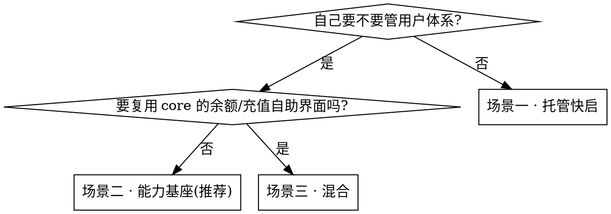

# Building on actionow-core

## Overview

**actionow-core is a capability base (能力基座), not your whole backend.** You build an AIGC product on top of it and reuse its identity, credits, top-up, model relay, and file storage — while keeping your own users, product UX, prompts, and business data.

> core 有两种用法。**用法 A · 全模态模型中转站**:一把租户级 `ak_` key 打 `/v1`,跨 chat / 图 / 视频 / 音频 / embeddings / rerank 全模态调用,不建 subject、不碰 `/console` 联邦——你只需要 [actionow-integration](../actionow-integration/SKILL.md),不需要本 skill。**用法 B · 基于 core 建应用(应用基座)**:在 A 的基础上,再把你自己的端用户联邦为 subject(每用户 key / 子钱包 / 限额 / 消费归属)。本 skill 讲的就是用法 B——用法 A 是它机制的严格子集,需要每用户钱包 / 限额 / 归属时再上 B。

Two layers, two skills:

- **[actionow-integration](../actionow-integration/SKILL.md) = 机制层** — how one call is written correctly (endpoints, auth, request/response, errors, billing, webhooks).
- **This skill = 工程/架构层** — how the whole app is built on core: what to reuse, what to build, and which integration posture to pick.

> 如果你要问的是「这一次调用怎么写对」,去 actionow-integration;这里回答「整个应用怎么建、复用什么、选哪种姿势」。

## 能直接复用什么

| core 的系统                                | 直接复用?  | 一句话                                                                                                           |
| ------------------------------------------ | ---------- | ---------------------------------------------------------------------------------------------------------------- |
| 用户系统                                   | ✅ Model-A | `subject` 作计费/归属身份 + 自助(读 me/usage/balance + 改资料/改密码 + 自建/吊销自己的 key);不是完整业务用户体系 |
| 积分系统                                   | ✅         | 信用账本:租户池 + 每用户子钱包,hold→settle,µcredit                                                               |
| 充值系统                                   | ✅         | 支付 intent + 卡密兑换 + 子钱包充值/划转                                                                         |
| 模型系统                                   | ✅         | OpenAI/Anthropic/Gemini 兼容中继 + 路由/容错/计费                                                                |
| 文件/存储                                  | ✅         | presign 上传/下载 + 配额                                                                                         |
| 业务档案·权限·产品 UX·Prompt 编排·领域数据 | ❌ 自建    | core 不存业务数据、不做产品逻辑                                                                                  |

Full matrix with boundaries and source facts: [reference/01-choose-your-scenario.md](reference/01-choose-your-scenario.md).

## 关键约束

端用户的 **member JWT 不能直连 `/v1`**(member-token 直连已下线)。真正的 AI 调用要经过 `ak_`:要么你的后端持 `ak_` 代理调用,要么给端用户发一把 **subject-scoped `ak_`**。

> 注意:member 可用自己的 member JWT 调 `POST /member/api-keys` **自助铸一把 `ak_`**,再用它打 `/v1`——等于端用户自助拿到数据面凭证。但这把 `ak_` 会落到前端,是安全取舍(见场景一)。

## 选哪种姿势

| 姿势                         | 你自持用户? | 你要建的                           | 适合                     | Playbook                                                                   |
| ---------------------------- | ----------- | ---------------------------------- | ------------------------ | -------------------------------------------------------------------------- |
| 场景一 · 托管快启            | 否(Model-A) | 前端 + 极薄 `ak_` 代理             | 内部工具 / DEMO / 轻产品 | [02-scenario-managed.md](reference/02-scenario-managed.md)                 |
| 场景二 · 能力基座 **(主线)** | 是(Model-B) | 用户/权限/业务库 + 联邦层 + 薄后端 | 长期演进的正式产品       | [03-scenario-capability-base.md](reference/03-scenario-capability-base.md) |
| 场景三 · 混合                | 是(Model-B) | 用户库 + 复用 core 自助/充值       | 想少写计费界面           | [04-scenario-hybrid.md](reference/04-scenario-hybrid.md)                   |

## 铁律(工程规则,机制细节见 actionow-integration)

1. **双 client 隔离**:控制面 USER JWT **仅服务端**(能为任意 subject 发 key、动账);数据面 `ak_` 按端用户。见 [../actionow-integration/reference/07-sdk-reference.md](../actionow-integration/reference/07-sdk-reference.md)。
2. **只存 core 的 ID,不镜像数据**:在你的用户行上存 `subject_id` / `file_id` / `job_id`,不要把 core 的余额/用量/文件复制进你的库(federation)。
3. **钱是 µcredit 字符串**:响应里的钱用 `BigInt` 解析,绝不用 `Number`;请求里的钱是人类数字。见 [../actionow-integration/reference/04-billing-and-limits.md](../actionow-integration/reference/04-billing-and-limits.md)。
4. **按 `retryable` 标志重试**:绝不重试 `402`/`400`;billed 的 `/v1/run` 重试带 body `idempotency_key`。见 [../actionow-integration/reference/05-errors-and-idempotency.md](../actionow-integration/reference/05-errors-and-idempotency.md)。
5. **webhook 原始字节验签 → 快速 ack → 回拉 job**:回调体是最小 ping(`{ job_id }`,失败时附 `error`/`status`)——验签后回拉 `GET /v1/jobs/:id` 为准。见 [../actionow-integration/reference/06-webhooks.md](../actionow-integration/reference/06-webhooks.md)。
6. **`end_user = <你的 external_id>`,不是 subject UUID**:core 按 `external_id` 归属/建号。见 [../actionow-integration/reference/01-authentication.md](../actionow-integration/reference/01-authentication.md)。

## 子技能

| 文件                                                                                 | 何时读                                             |
| ------------------------------------------------------------------------------------ | -------------------------------------------------- |
| [reference/01-choose-your-scenario.md](reference/01-choose-your-scenario.md)         | 决定复用什么、选哪种姿势(完整复用矩阵 + 决策树)    |
| [reference/03-scenario-capability-base.md](reference/03-scenario-capability-base.md) | **主线**:自持用户,把 core 当能力基座(Model-B)      |
| [reference/02-scenario-managed.md](reference/02-scenario-managed.md)                 | 托管快启:最少自建,尽快上线(Model-A)                |
| [reference/04-scenario-hybrid.md](reference/04-scenario-hybrid.md)                   | 混合:自持用户 + 复用 core 的余额/充值自助          |
| [reference/05-migration-A-to-B.md](reference/05-migration-A-to-B.md)                 | 升级路径:托管快启 → 能力基座                       |
| [reference/06-tech-stack.md](reference/06-tech-stack.md)                             | 技术栈选型:前端 / 后端 / DB / 中间件(与 core 一致) |

人读版工程指南(定位 + 技术栈 + 编码/自身 API 规范):[docs/ENGINEERING-GUIDE.md](../../docs/ENGINEERING-GUIDE.md)。

## 脚本

| 脚本                                                         | 作用                                                           |
| ------------------------------------------------------------ | -------------------------------------------------------------- |
| [scripts/onboard-and-call.mjs](scripts/onboard-and-call.mjs) | 场景二端到端:登录 → 建 subject → 发 key →(可选)兑换充值 → chat |

## 环境变量

本组织的线上网关:**`https://core.actionow.ai`**(Swagger:`https://core.actionow.ai/docs`)。沿用 actionow-integration 的约定(见其 SKILL.md「Setup」):`ACTIONOW_BASE_URL`(= `https://core.actionow.ai`)、`ACTIONOW_API_KEY`(数据面 `ak_`)、`ACTIONOW_CONSOLE_EMAIL` / `ACTIONOW_CONSOLE_PASSWORD`(控制面登录)。
